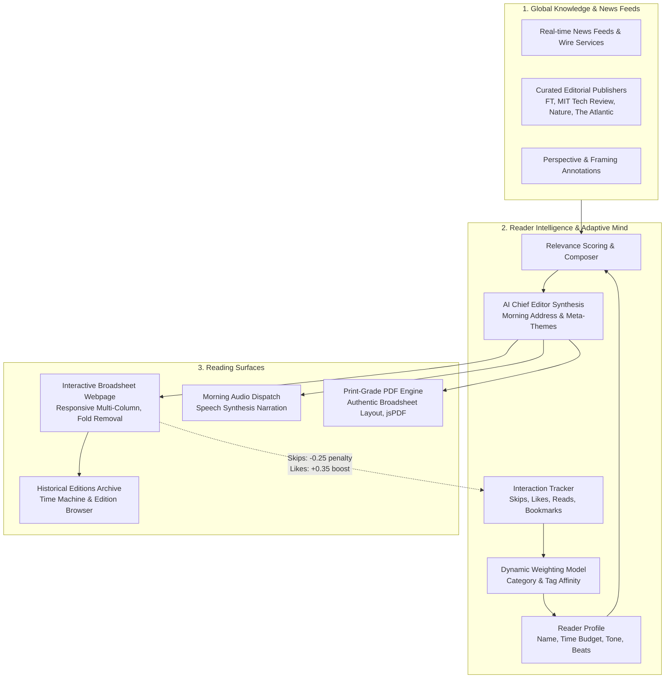

# System Architecture: The Personal Morning Paper

## 1. System Overview

**The Personal Morning Paper** is an intelligent publication system that transforms scattered, overwhelming web news into a finite, elegant daily broadsheet tailored to each reader's schedule, cognitive style, and passions.

---

## 2. Core Architectural Pillars

### A. The Ingestion & Relevance Scoring Model
Every candidate article $A_i$ receives a dynamic relevance score $S(A_i)$ computed at press time:

$$S(A_i) = \left( B_{cat} \times W_{cat} \right) + \sum_{k \in Tags} \left( M_k \times W_k \right) - P_{skip} + R_{novelty}$$

Where:
- $B_{cat}$: Base affinity from user's configured beats (1.4 if chosen, 0.6 if unchosen).
- $W_{cat}$: Learned category weight (ranges from $0.20$ to $3.50$).
- $M_k$: Keyword match multiplier ($+0.80$ for user-defined tags).
- $W_k$: Learned keyword affinity weight.
- $P_{skip}$: Severe skip penalty ($-3.00$ if skipped recently, preventing unwanted repetition).
- $R_{novelty}$: Time-decay factor ensuring fresh morning perspectives.

The highest-scoring article is designated the **Front Page Anchor / Lead Story**, while subsequent articles populate the **Side Dispatches** and thematic broadsheet sections.

---

### B. The Adaptive Feedback Loop ("The Editorial Mind")
Traditional news feeds operate on mindless engagement loops (clicks, anger, doomscrolling). The Personal Morning Paper reverses this with deliberate, high-intent signals:

| Reader Action | Algorithmic Impact | Editorial Consequence |
|---|---|---|
| **Skip Article** | Category $-0.25$, Tags $-0.20$ | Instantly folds away story; deprioritizes topic in tomorrow's edition. |
| **Read / Expand** | Category $+0.15$, Tags $+0.15$ | Signals intellectual resonance; balances future column depth. |
| **Like / Star** | Category $+0.35$, Tags $+0.25$ | Strong reinforcement; elevates related themes to Front Page candidate. |
| **Bookmark** | Saved to archive | Preserved for evening deep reading. |

The **AI Mind Drawer** provides 100% transparency into this matrix, displaying real-time category affinity scores and a live signal audit log.

---

### C. Multi-Modal Presentation Engines

1. **Interactive Broadsheet Webpage**:
   - Styled with authentic 19th/20th-century print typography (`Cinzel`, `Playfair Display`, `Merriweather`).
   - Features classic double-rules, true drop caps, pull quotes, bylines, and issue numbers.
   - Interactive article reader with full text, key takeaways, and outbound links to original publisher articles.
   - Built-in theme switch: **Paper Broadsheet** (Cream ivory), **Midnight Edition** (Slate dark), and **Sepia Archive**.

2. **Print-Grade PDF Engine**:
   - Client-side vector rendering via `html2canvas` (2x DPI scale) and `jsPDF`.
   - Authentic broadsheet proportions formatted for printing or offline reading on tablets/e-readers.

3. **Morning Audio Dispatch**:
   - Browser `SpeechSynthesis` audio narration engine.
   - Reads weather, Chief Editor's morning note, lead headline, and summaries at adjustable speeds (1x, 1.25x, 1.5x).

---

## 3. "Room to Explore" Distinctive Features

1. **Chief Editor's Desk**: An AI-synthesized morning address that synthesizes disparate headlines into a unified civilizational or technological narrative.
2. **The Nuance Lens**: A 3-way comparative perspective dial displaying distinct framing worldviews on contentious issues (e.g., Technological Optimism, Economic Realignment, Systemic Vulnerability).
3. **The Coffee Break**: Daily intellectual riddle, Word of the Morning (with etymology), and historical newspaper trivia.
4. **Time Machine Archive**: Allows readers to browse previous days' papers and track how their paper evolved.
