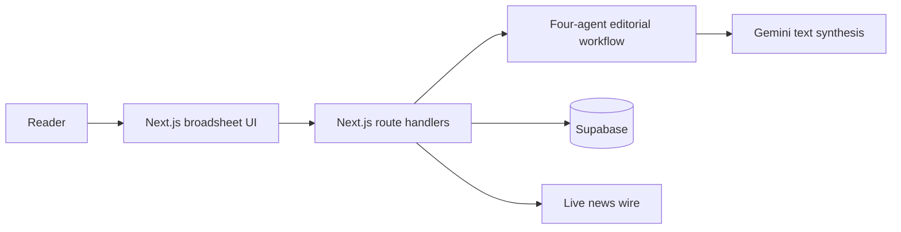

# System Architecture: Jimmy Morning Chronicle

## Overview

Jimmy Morning Chronicle is a Next.js 16 personal digital newspaper. It creates a reader-specific morning edition, learns from reading feedback, stores user data in Supabase, and provides optional Gemini-powered text features.

Image generation has been removed. The product does not use Gemini, Imagen, or any other service to generate editorial artwork.

## Editorial workflow

The Newsroom Orchestrator coordinates four focused agents:

1. **Chief Editor (Aura-1)** writes the Morning Address using Gemini text synthesis when configured.
2. **Curator and Reranker (Nexus-4)** ranks stories with reader preferences and learned weights.
3. **Perspective and Nuance (Vantage-2)** provides a three-viewpoint perspective for the lead story.
4. **Culture and Leisure (Minerva-3)** prepares the Coffee Break puzzle and word feature.

The workflow returns a complete text-first edition for the web page and PDF export.

## Gemini integration

`src/lib/gemini.ts` only makes text-generation requests. It supports:

- The Chief Editor Morning Address.
- Ask The Paper, which answers from the current edition and cites its articles.

`GEMINI_API_KEY` is server-only and is never exposed to the browser. The application contains no image-generation endpoint or image-generation API calls.

## Server routes

| Route | Method | Purpose |
| --- | --- | --- |
| `/api/agents/editorial` | POST | Builds an edition with the four-agent workflow. |
| `/api/profile` | GET / POST | Reads and saves reader preferences. |
| `/api/signals` | GET / POST | Reads learning signals. |
| `/api/signals/action` | POST | Records a skip, read, like, or bookmark. |
| `/api/ask-paper` | POST | Answers a question about the current edition using Gemini text. |
| `/api/news/live` | GET | Retrieves live wire headlines. |
| `/api/health` | GET | Checks server, Supabase, and Gemini-text availability. |

## Data and deployment

Supabase stores reader profiles, articles, editions, interactions, and learned category and keyword weights. The schema is in `supabase/migrations/20261017_init.sql`.

The app is deployed on Vercel at https://personal-morning-paper.vercel.app. Pushing to the `main` branch triggers an automatic deployment.
