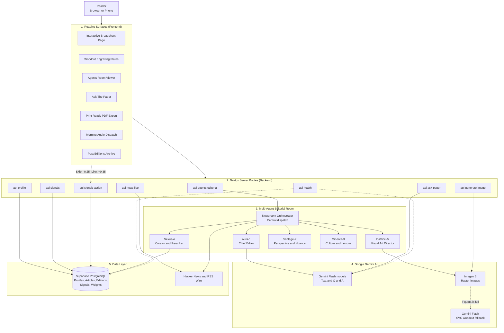
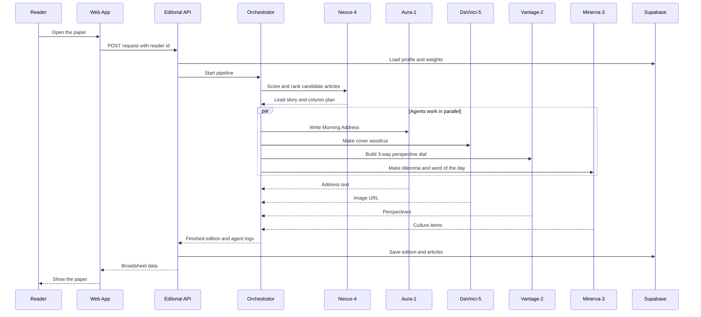
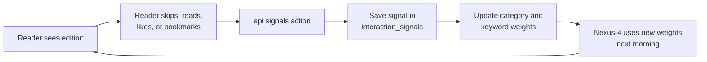
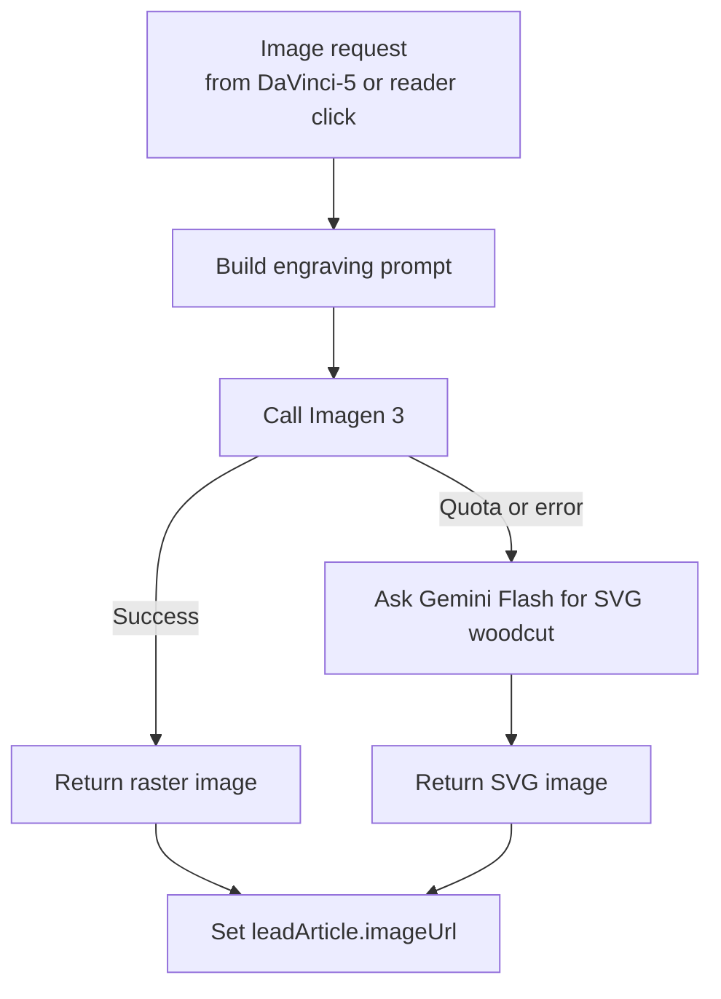
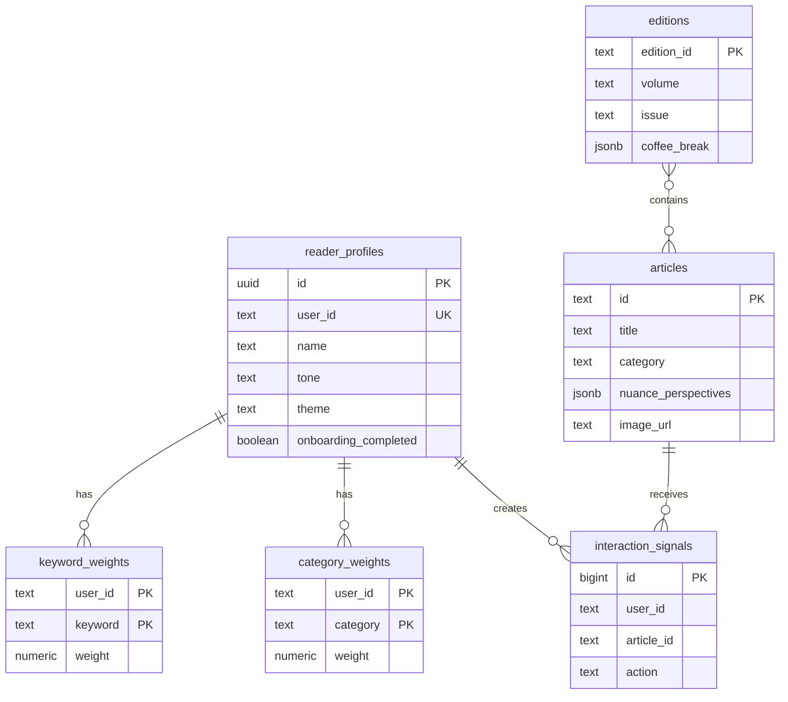
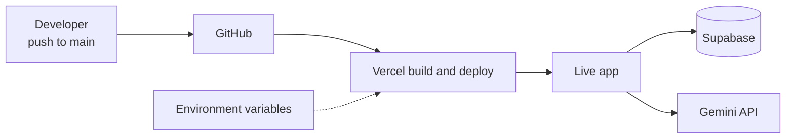
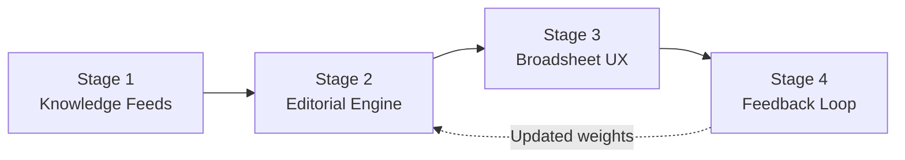

# System Architecture: Jimmy Morning Chronicle

## 1. System Overview

Jimmy Morning Chronicle is a personal digital newspaper. It looks like an old 19th century broadsheet, but it is built with modern tools.

Main building blocks:

- **Next.js 16 App Router** for the web pages and server routes.
- **Five AI agents** (the Multi-Agent Editorial Room) that work together to build each morning edition.
- **Google Gemini AI** for writing text and for making images.
- **Supabase PostgreSQL** for saving reader data, articles, editions, and feedback.

The app can do these things:

- Build a daily edition that fits each reader.
- Draw a Victorian style woodcut picture for the cover story.
- Answer questions about today's paper ("Ask The Paper").
- Read stories aloud (audio dispatch).
- Export the paper as a print-ready PDF.
- Learn from what the reader skips, reads, likes, or bookmarks.

### 1.1 High Level Architecture Diagram

### 1.2 Request Flow: Building a Morning Edition

This diagram shows what happens when a reader opens the paper.

### 1.3 Feedback Loop

---

## 2. Multi-Agent Editorial Room

Instead of one big prompt, five small agents each do one job. They share their results on a common "editorial blackboard". The Newsroom Orchestrator controls the order of work and collects the output.

### A. Chief Editor Agent (Aura-1)

- **Role**: Editorial voice and big picture summary.
- **What it does**:
  - Reads candidate headlines from around the world.
  - Finds the main story or theme of the day.
  - Writes the **Chief Editor Morning Address**. It uses the reader's name, time budget, and preferred tone (analytical, executive, curious, or provocative).
  - Uses `gemini-2.5-flash` or `gemini-3.8-flash` through `src/lib/gemini.ts`.

### B. Curator and Reranker Agent (Nexus-4)

- **Role**: Scores articles and plans the page layout.
- **What it does**:
  - Compares each candidate article with the reader's favorite topics and learned weights.
  - Gives each article a relevance score:

    `S(Ai) = (B_cat x W_cat) + sum(M_k x W_k) - P_skip + R_novelty`

  - What the symbols mean:
    - `B_cat`: base score for the article's category.
    - `W_cat`: the reader's learned weight for that category.
    - `M_k` and `W_k`: keyword matches and the reader's learned weight for each keyword.
    - `P_skip`: a penalty if the reader often skips this kind of story.
    - `R_novelty`: a small bonus for fresh topics, so the paper does not get boring.
  - Picks the **Front Page Lead Story**, the side dispatches, and the themed columns.

### C. Visual Art Director and Engraver Agent (DaVinci-5)

- **Role**: Art direction and image generation.
- **What it does**:
  - Looks at the lead story headline, category, and subhead.
  - Writes an image prompt for a Victorian newspaper engraving. The prompt asks for black and white cross-hatching, a framing border, and a symbolic scene.
  - Calls `generateImageWithGemini` to make the cover art with Imagen 3 (`imagen-3.0-generate-002:predict`). If that fails, it uses Gemini Flash to draw an SVG woodcut.
  - Saves the result in `leadArticle.imageUrl`. The picture is used on the page, in the modal view, and in the PDF.

### D. Perspective and Nuance Agent (Vantage-2)

- **Role**: Balance and bias checks.
- **What it does**:
  - Reviews stories that are complex or divide opinion.
  - Builds a **3-Way Perspective Dial** that shows the story from three angles. Example angles: Technological Capability, Capital and Economic Speed, and Systemic Risk.

### E. Culture and Leisure Agent (Minerva-3)

- **Role**: Light reading and morning reflection.
- **What it does**:
  - Makes the daily **Coffee Break Dilemma** and checks the reader's guesses.
  - Picks the **Word of the Morning** with its sound and word origin.
  - Adds press history trivia, going back to Fleet Street in 1702.

---

## 3. Gemini AI Integration

### 3.1 Text and Question Answering

- **Client**: `src/lib/gemini.ts`, using the `@google/genai` package.
- **Model fallback**: The client tries `gemini-2.5-flash` first, then `gemini-3.8-flash`, then `gemini-flash-latest`. If one model fails, the next one is used.
- **Chief Editor Address**: `src/agents/ChiefEditorAgent.ts` builds a prompt with the day's themes, the reader profile, and the tone. The reply from Gemini is shown in the Morning Address block.
- **Ask The Paper**: `src/app/api/ask-paper/route.ts` builds a small knowledge base from today's article summaries and lead paragraphs. It sends the reader's question to Gemini with a system prompt that requires answers to cite the articles.

### 3.2 Image Generation Pipeline

- **Service**: `generateImageWithGemini(prompt, options)` in `src/lib/gemini.ts`.
- **Imagen 3 (main path)**:
  - Endpoint: `https://generativelanguage.googleapis.com/v1beta/models/imagen-3.0-generate-002:predict?key=${GEMINI_API_KEY}`
  - Makes 16:9 high resolution broadsheet pictures.
- **Gemini Flash SVG woodcut (fallback path)**:
  - Used when the image quota is used up.
  - Draws a scalable Victorian style SVG woodcut.
  - Keeps the style rules: ink line work only, cross-hatching, and a classic frame.
- **Regenerate on demand**:
  - Readers can click **Regenerate Art (Gemini)** on the cover story.
  - The page calls `/api/generate-image` and swaps the new picture into the live edition.
- **Secret key**: `GEMINI_API_KEY` stays on the server only. It is never sent to the browser.

---

## 4. Database: Supabase PostgreSQL

All tables are created in PostgreSQL 15 or newer. The schema file is `supabase/migrations/20261017_init.sql`.

### 4.1 Tables

1. **`reader_profiles`**
   - `id` (UUID, primary key).
   - `user_id` (TEXT, unique): the reader's identity.
   - `name`, `location`, `newspaper_name`, `motto`: used for the masthead.
   - `reading_time`: `5min`, `15min`, or `30min`.
   - `tone`: `analytical`, `executive`, `curious`, or `provocative`.
   - `topics` (JSONB): main topics the reader follows.
   - `keywords` (JSONB): smaller topics and tags.
   - `theme`: `broadsheet`, `midnight`, or `sepia`.
   - `onboarding_completed`: true or false.

2. **`articles`**
   - `id` (TEXT, primary key): unique story id.
   - `title`, `subhead`, `author`, `outlet`, `outlet_url`, `published_at`, `category`: basic details.
   - `tags` (JSONB), `reading_minutes`, `lead_paragraph`, `full_body` (JSONB), `pull_quote`, `image_url`: story content.
   - `nuance_perspectives` (JSONB): the different viewpoints.

3. **`editions`**
   - `edition_id` (TEXT, primary key): an id that includes the date.
   - `volume`, `issue`.
   - `weather` (JSONB), `morning_quote` (JSONB), `chief_editor_note` (JSONB), `coffee_break` (JSONB).

4. **`interaction_signals`**
   - `id` (BIGSERIAL, primary key).
   - `user_id`, `article_id`, `title`, `category`.
   - `action`: `skip`, `read`, `like`, or `bookmark`.
   - `created_at`.

5. **`category_weights`** and **`keyword_weights`**
   - `user_id` plus `category` or `keyword` form the primary key.
   - `weight` (NUMERIC): how much the reader likes this item. The value stays between 0.20 and 3.50.

### 4.2 Table Relationships

---

## 5. Next.js Server Routes

| Route | Method | What it does |
|---|---|---|
| `/api/agents/editorial` | POST | Runs the 5-agent pipeline. Returns the finished broadsheet and live agent logs. |
| `/api/generate-image` | POST / GET | Makes woodcut pictures with Gemini (Imagen 3 or SVG fallback). |
| `/api/profile` | GET / POST | Reads and saves reader settings in Supabase. |
| `/api/signals` | GET / POST | Returns the weight matrix and logs reader actions. |
| `/api/signals/action` | POST | Saves one skip, read, like, or bookmark action. |
| `/api/ask-paper` | POST | Answers questions with citations from today's articles, using Gemini. |
| `/api/news/live` | GET | Gets live wire news from the Hacker News API. |
| `/api/health` | GET | Checks the server, Supabase, and Gemini connection. |

---

## 6. Design System and UI

### 6.1 Color Tokens (`src/index.css`)

All colors are CSS custom properties on `:root`, one set for each theme:

- **Broadsheet** (default): warm cream paper with dark ink text.
- **Midnight**: very dark background with strong amber accents.
- **Sepia**: old parchment with cognac colored borders.

All three themes meet WCAG AA or AAA contrast rules for the `text-muted`, `text-secondary`, and `text-primary` tokens.

### 6.2 Grid Layout Rules

- **Front page**: a 2 to 1 grid (`grid-template-columns: 2fr 1fr`). The Morning Intelligence Wire card fills the side column so it matches the height of the lead story.
- **Single card rule**: `.section-grid-modern:has(> :only-child)` limits a lone section card to 580px. This stops it from stretching across the whole page.
- **Responsive breakpoints**:
  - At 1024px, the 2 to 1 grid becomes one column.
  - At 768px, the footer and navigation grids become simpler.

### 6.3 Sticky Navigation

- `.modern-top-bar` uses `position: sticky; top: 12px; z-index: 80; backdrop-filter: blur(20px)`.
- It keeps PDF export, theme controls, and reader settings in reach while the reader scrolls.

### 6.4 Print Styles (`@media print`)

- Hides buttons, search bars, and floating chips.
- Shows articles and woodcut pictures as clean newsprint with borders.
- Uses `page-break-inside: avoid` so stories do not split across pages.

---

## 7. Main Features

1. **AI Woodcut Engravings**: The front page cover story gets a Victorian woodcut made by Gemini image generation.
2. **Newsroom Inspector**: A live window that shows what the 5 agents are thinking and doing, step by step.
3. **Ask The Paper**: A Gemini assistant that answers questions using today's paper.
4. **Interactive Coffee Break**: A puzzle with live answer checking, confetti, and a solution reveal.
5. **Text and Audio Controls**: Font size buttons (A- and A+), narration for the whole paper or one story, and quote sharing.
6. **Print Ready PDF**: One click export of the paper with woodcut art.
7. **Morning Intelligence Wire**: A side column with live market and frontier tech updates.
8. **Editorial Footer**: A multi-column footer with section links, console shortcuts, and a back-to-top button.

---

## 8. Deployment

- **Platform**: Vercel, with automatic deploys from the `main` branch.
- **Live URL**: https://personal-morning-paper.vercel.app
- **Required environment variables on Vercel**:
  - `GEMINI_API_KEY` (server only)
  - `NEXT_PUBLIC_SUPABASE_URL`
  - `NEXT_PUBLIC_SUPABASE_ANON_KEY`
  - `SUPABASE_SERVICE_ROLE_KEY` (server only)

---

## 9. Four Stage Pipeline

Each morning edition moves through four stages:

| Stage | Name | Inputs | Outputs |
|---|---|---|---|
| 1 | Knowledge Feeds | Global wire and RSS, outlets for many topics, perspective data | Raw candidate articles |
| 2 | Editorial Engine | Candidate articles, reader profile, learned weights | A ranked edition made by 5 agents, with Gemini image generation |
| 3 | Broadsheet UX | Finished edition and woodcut plates | Interactive web page, Morning Audio Dispatch, high resolution PDF |
| 4 | Feedback Loop | Reader actions (skip, read, like, bookmark) | Updated Bayesian weight matrix |

> **Continuous learning**: Every reader action updates the weight matrix right away. The next morning, the lead story and column order change to match.

---

## 10. Product Walkthrough Guide

A suggested 5 minute demo:

| Time | Topic | What to show |
|---|---|---|
| 0:00 to 1:00 | Problem and Onboarding | Explain the problem of news being scattered everywhere. Walk through the onboarding "printing press" setup (name, topics, tone, reading time). |
| 1:00 to 2:30 | Digital Broadsheet | Show the masthead, the lead story with its Gemini woodcut, the Morning Audio Dispatch, the multi-column sections, and the theme switcher. |
| 2:30 to 3:30 | Adaptive Learning | Skip an article (weight drops by 0.25). Like a story (weight rises by 0.35). Open the Learning Matrix Drawer to see the weights move. Run Simulate Next Morning. |
| 3:30 to 4:15 | More Features | Show the Chief Editor Morning Address, on-demand image re-engraving, the Nuance Lens 3-way dial, the Coffee Break dilemma, and the Past Editions Archive. |
| 4:15 to 5:00 | PDF and Architecture | Export the PDF in one click. Open the About window to show the tech stack. Point to ARCHITECTURE.md on GitHub. |