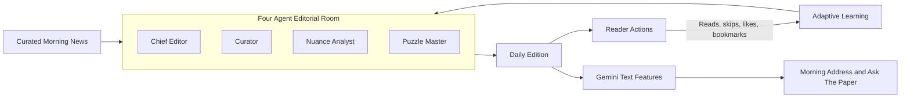

<div align="center">

<!-- Animated header banner -->


<br/>


<br/>

[Live App](https://personal-morning-paper.vercel.app) &nbsp;|&nbsp; [Repository](https://github.com/AbdulAzeemHashmi/personal-morning-paper) &nbsp;|&nbsp; [Architecture](./ARCHITECTURE.md)

</div>

---

## Table of Contents

- [Overview](#overview)
- [Features](#features)
- [How It Works](#how-it-works)
- [The Editorial Room](#the-editorial-room)
- [Tech Stack](#tech-stack)
- [Image Generation Removed](#image-generation-removed)
- [Quickstart](#quickstart)
- [Environment Variables](#environment-variables)
- [Database Setup](#database-setup)
- [Deployment](#deployment)

---

## Overview

**Jimmy Morning Chronicle** is a personal digital newspaper. It takes curated morning news and turns it into a calm, focused daily reading experience, laid out like a classic broadsheet.

The app is built with Next.js and uses a four agent editorial workflow to put each edition together. Supabase stores your data, and Google Gemini writes text summaries and answers your questions about the news.

<div align="center">

</div>

---

## Features

| Feature | What it does |
|---|---|
| **Personalized daily editions** | Each edition adapts to you by learning from what you read, skip, like, and bookmark |
| **Four agent editorial room** | A Chief Editor, a Curator, a Nuance Analyst, and a Puzzle Master build the paper |
| **Morning Address** | A short opening message written by Gemini |
| **Ask The Paper** | Ask a question and get an answer based on the paper's own content |
| **Audio narration** | Listen to the paper instead of reading it |
| **PDF export** | Save an edition as a PDF file |
| **Archive** | Go back and read past editions |
| **Live news wire** | See the latest headlines as they come in |
| **Responsive broadsheet themes** | The layout works on phones, tablets, and desktops |

---

## How It Works

<div align="center">



</div>

Your reading habits feed back into the next edition, so the paper gets more useful the more you use it.

---

## The Editorial Room

Four agents work together like a real newsroom to build each edition.

- **Chief Editor**
- **Curator**
- **Nuance Analyst**
- **Puzzle Master**

For the full design of the workflow, see [ARCHITECTURE.md](./ARCHITECTURE.md).

---

## Tech Stack

| Technology | Used For |
|---|---|
| **Next.js** | The web app and its pages |
| **Supabase** | Saving data and learning from reader actions |
| **Google Gemini** | Morning Address and Ask The Paper, text only |
| **Vercel** | Hosting and automatic deployment |

---

## Image Generation Removed

This app does not create, redraw, or show any AI generated artwork.

- It does not call the Gemini API, Imagen, or any other model to make images.
- Gemini is used only for text features.

---

## Quickstart

```bash
git clone https://github.com/AbdulAzeemHashmi/personal-morning-paper.git
cd personal-morning-paper
npm install
npm run dev
```

Then open [http://localhost:3000](http://localhost:3000) in your browser.

---

## Environment Variables

Create a `.env.local` file if you want to use the optional text features that need a server.

```env
# Gemini text features and Ask The Paper only
GEMINI_API_KEY=your_gemini_api_key

NEXT_PUBLIC_SUPABASE_URL=https://your-project.supabase.co
NEXT_PUBLIC_SUPABASE_ANON_KEY=your-anon-key
SUPABASE_SERVICE_ROLE_KEY=your-service-role-key
```

| Variable | Purpose |
|---|---|
| `GEMINI_API_KEY` | Powers the Morning Address and Ask The Paper. Used for text only |
| `NEXT_PUBLIC_SUPABASE_URL` | The URL of your Supabase project |
| `NEXT_PUBLIC_SUPABASE_ANON_KEY` | The public key for your Supabase project |
| `SUPABASE_SERVICE_ROLE_KEY` | The private server key for your Supabase project. Never share it |

---

## Database Setup

Open the SQL editor in your Supabase project and run the file below.

```
supabase/migrations/20261017_init.sql
```

---

## Deployment

- **Live app:** [personal-morning-paper.vercel.app](https://personal-morning-paper.vercel.app)
- **Repository:** [github.com/AbdulAzeemHashmi/personal-morning-paper](https://github.com/AbdulAzeemHashmi/personal-morning-paper)

Vercel deploys every change that is pushed to the `main` branch.

---

<div align="center">


</div>